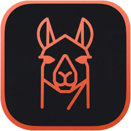
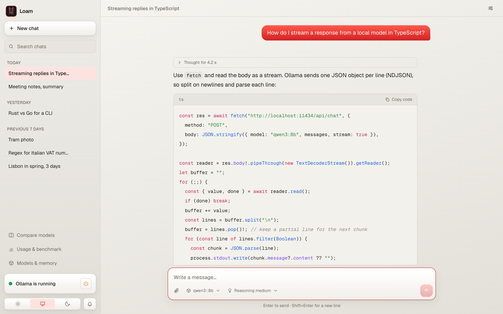

<p align="center">
  
</p>

<h1 align="center">Loam</h1>

<p align="center">
  <strong>Chat client for Local Offline AI Models, on macOS.</strong><br>
  One interface for Ollama, LM Studio, llama.cpp and MLX.
</p>

<p align="center">
  <a href="https://github.com/fcarlucc/loam/actions/workflows/ci.yml"></a>
  <a href="LICENSE"></a>
  
</p>

<p align="center">
  <picture>
    <source media="(prefers-color-scheme: dark)" srcset="docs/screenshots/chat-dark.png">
    
  </picture>
</p>

Loam is a chat app for the AI models that run on your own computer. It works with [Ollama](https://ollama.com) out
of the box, and with LM Studio, llama.cpp, MLX or any other local server that speaks the OpenAI chat API. No account,
no cloud, no telemetry: everything lives on your Mac.

## Why

Local engines are great at running models and plain at chatting with them. I wanted what I was used to in the big
chat apps (message versions, branches, search, attachments, reasoning controls) for the models on my own machine, in
one app whatever engine runs them. The other options were a bare chat box or a server platform that needs Docker.
Loam is the one in between: a fast, polished app for one person, the way I like to use it every day.

## Features

**Chat**
- Streaming replies with Markdown and syntax-highlighted code; stop, regenerate, retry
- Edit a sent message or regenerate a reply: every version is kept, switch between them with ◀ 2/3 ▶
- Regenerate a reply with another model, from any engine, to compare: the new version says which model wrote it
- Branch a conversation from any reply into a new chat
- Reasoning models: turn reasoning off, on or to a level per chat, and read what the model thought
- Text, code and image attachments, kept with the chat and deleted with it
- Per-chat system prompt, temperature and context length
- Compact a long chat: the model summarizes the older messages to free its context, by hand or automatically when
  the context is nearly full; the summary can be read and undone
- Speed, tokens and context use under every reply
- Keyboard first: ⌘K opens a command palette for every action, chat and model; ⌘/ lists the shortcuts

**History**
- Chat list grouped by date, with full-text search across every message
- Deleting a chat wipes its text from the database files, not just from the list
- Temporary chats: never saved, never listed or searchable, gone once you leave them

**Models**
- Every local engine in one place: the model picker groups models by engine, and the sidebar shows which are running
- One-click download of popular Ollama models, labelled by how well they fit your Mac's memory
- See what's loaded in memory and free it; start and stop Ollama from the sidebar
- Two models side by side on the same prompt, to help you pick one

**Privacy**, details in [SECURITY.md](SECURITY.md)
- The app listens on `127.0.0.1` only, and rejects requests from other websites
- The page loads nothing from the internet, and images in replies are never loaded automatically
- Engines must be on this machine unless you opt in explicitly
- All of this is covered by tests that run on every push

## Getting started

Requirements: macOS, Node.js `^22.13.0 || >=23.4.0`, and at least one engine (see below).

```bash
npm install
npm run dev       # with Homebrew's Ollama: starts it, and stops it when the app exits
npm run dev:raw   # with the Ollama app, or any engine that is already running
```

Then open the address printed in the terminal (<http://localhost:3000>, or the next free port). For daily use,
`npm run build && npm start` runs the faster production build on <http://127.0.0.1:3000>.

## Engines

Loam is a client: it connects to the engines you already run and never runs models itself. Ollama at
`http://localhost:11434` is set up from the start. To add another, open **Engines** in the sidebar, pick a preset,
check the URL and press **Test connection**.

| Engine | Start it with | Preset URL |
| --- | --- | --- |
| [Ollama](https://ollama.com) | the Ollama app, or `brew install ollama` | `http://localhost:11434` |
| [LM Studio](https://lmstudio.ai) | Developer tab, "Start server" | `http://127.0.0.1:1234/v1` |
| [llama.cpp](https://github.com/ggml-org/llama.cpp) | `llama-server -m model.gguf` | `http://127.0.0.1:8080/v1` |
| [MLX](https://github.com/ml-explore/mlx-lm) | `mlx_lm.server --model …` | `http://127.0.0.1:8080/v1` |
| Anything else | a server with the OpenAI chat API | its base URL, usually ending in `/v1` |

Chatting works the same everywhere. Downloading, deleting and unloading models are Ollama only; the other servers
manage their own models. Details in [docs/ENGINES.md](docs/ENGINES.md).

Only engines on this machine are accepted (`localhost`, `127.0.0.1`, `[::1]`): an engine on another computer would
send your messages over the network. To allow it anyway, start the app with `ALLOW_REMOTE_ENGINES=1`; such engines
are then marked **Remote**.

## Data and configuration

Chats and settings live in `data/` (ignored by git). To back them up, copy the whole folder while the app is stopped:
SQLite keeps recent changes in `ollama-wrap.db-wal` next to the database, so the `.db` file alone may be incomplete.

| Variable | Default | |
| --- | --- | --- |
| `OLLAMA_HOST_URL` | `http://localhost:11434` | Where the built-in Ollama is |
| `OLLAMA_WRAP_DATA_DIR` | `data/` | Where chats and settings are stored |
| `ALLOW_REMOTE_ENGINES` | unset | `1` accepts engines on other machines |

## Roadmap

- **v0.2 · Easy install**: works with any Ollama install; one-command install; data in
  `~/Library/Application Support/Loam`
- **v0.3 · Tools and projects**: MCP tools with an approval step before anything runs; projects that group chats with
  shared instructions and files
- **v0.4 · Desktop app**: a native macOS app with a global shortcut, keeping every feature and the UI
- **Later**: chat with your documents (local, with cited sources), PDF attachments, prompt library, export and import,
  local voice input

Progress is tracked in the [issues](https://github.com/fcarlucc/loam/issues).

## Contributing

Issues and pull requests are welcome: see [CONTRIBUTING.md](CONTRIBUTING.md) for setup and tests. Please report
security issues privately, as described in [SECURITY.md](SECURITY.md).

## License

[MIT](LICENSE)
